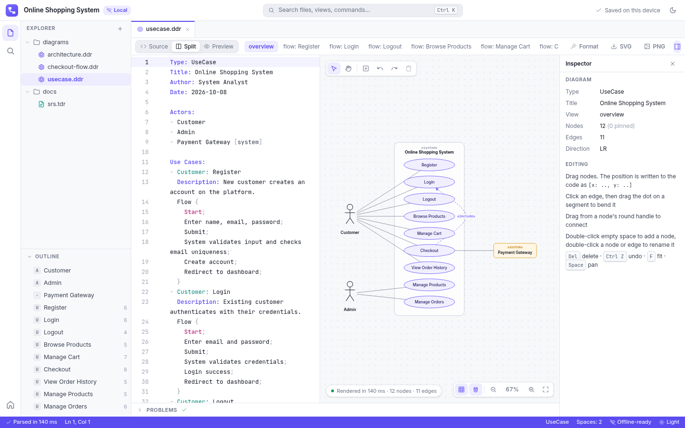
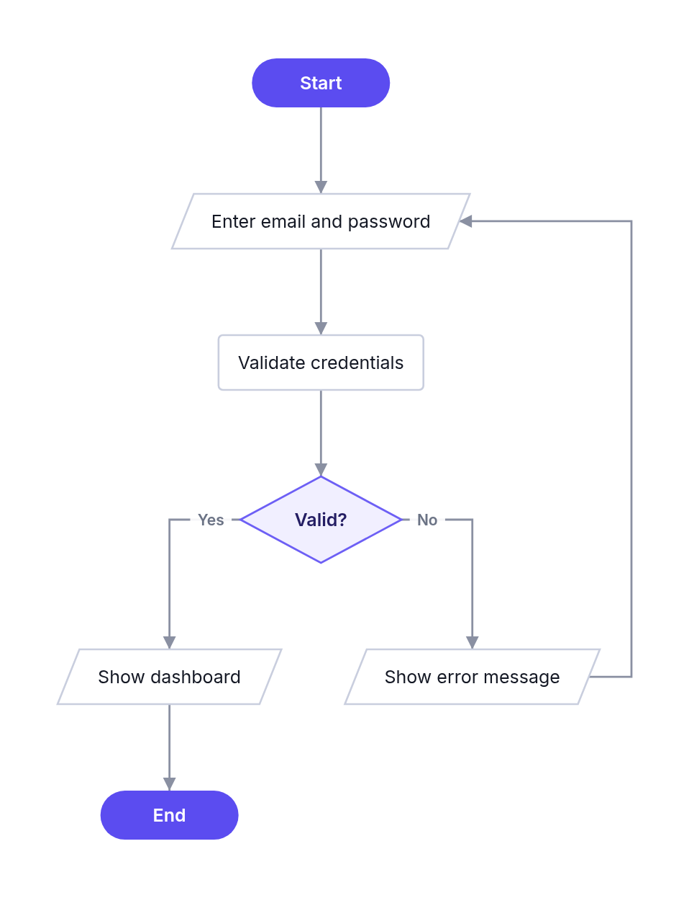
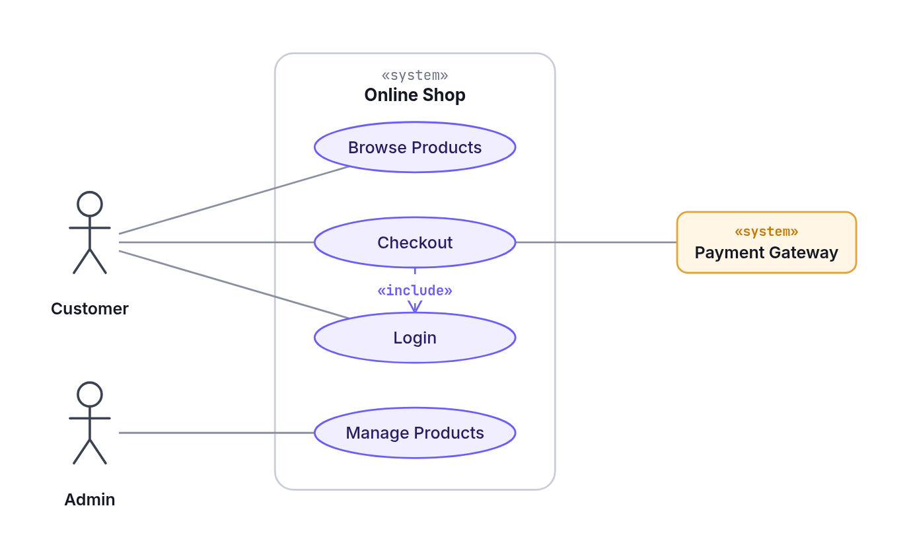
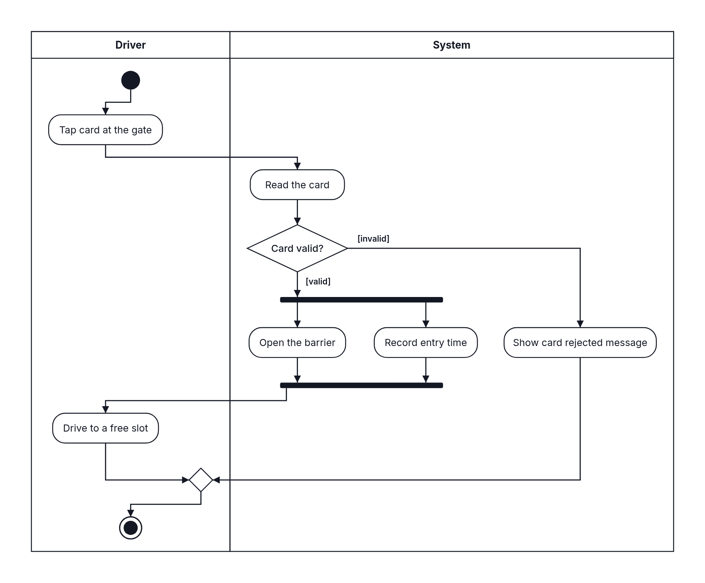
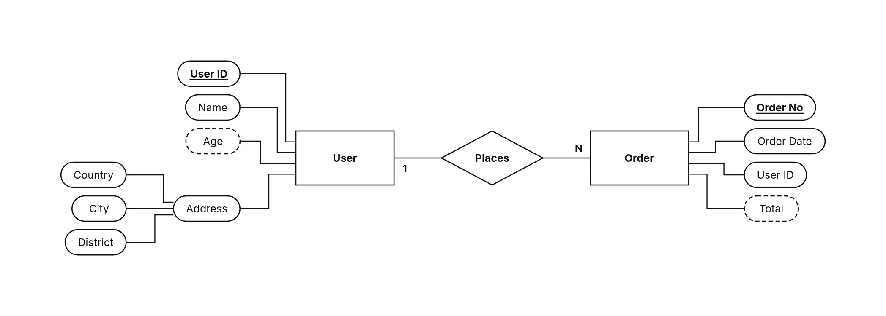
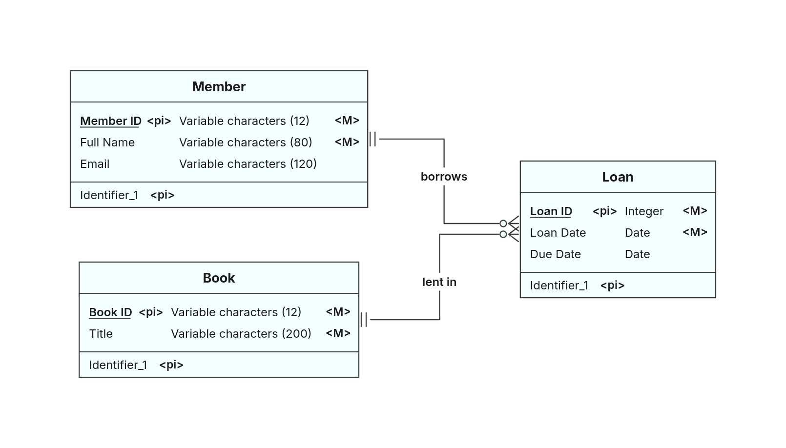
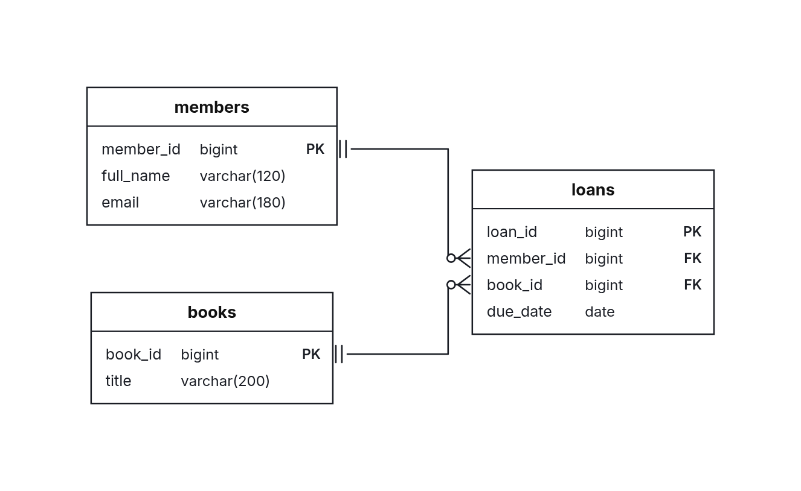
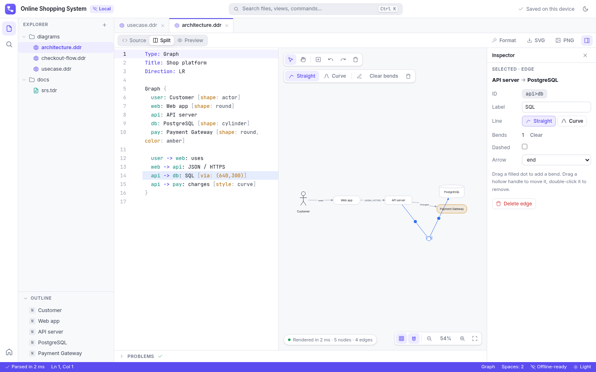
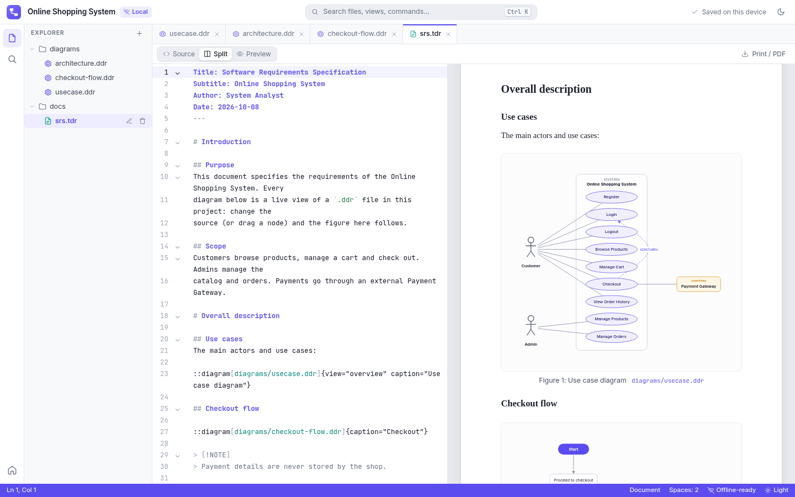

# DDR: Diagram Done Right  

The more you learn about software engineering, the less you'll write code, and the more you'll write documentation. This is what I call a "Diagram Done Right" (DDR), it eliminates the need to manually design and make diagram using markup code `.ddr` to keep you focused on keyboard and brainstorm along with LLM.  

## What it is

DDR is a document workspace for software engineers. You write diagrams and documents as plain text, and DDR draws them for you.

- **`.ddr` (Diagram Done Right)** for use case diagrams, flowcharts and graphs. Source on the left, live diagram on the right, like Overleaf.
- **`.tdr` (Text Done Right)** for SRS, papers and reports. It's Markdown that can embed any `.ddr` view, so your document always shows the latest diagram.
- **Both ways editable.** Drag a node, bend an edge (straight or curved) or rename a label in the diagram, and DDR writes only that change back into your code. Edit the code, and the diagram follows.
- **Offline first.** This repo is the standalone PWA: everything runs in your browser and your files stay on your device. Install it from the address bar and it works without internet.

Try it here: **https://fastering.thedev.id/ddr-free/**



## Syntax

Every `.ddr` file starts with a header (`Type:`, `Title:`, and optionally `Author:`, `Date:`, `Lang:`), followed by the body for that diagram type. Lines starting with `#` are comments. Positions are optional: drag anything in the preview and DDR writes `[x, y]` back into the code.

| Type | Body | Notes |
|------|------|-------|
| [Flowchart](#flowchart) | `Flow { }` | `if` / `else`, `loop`, `goto id`, input/output steps |
| [Use case](#use-case) | `Actors:`, `Use Cases:` | `Includes`, `Extends`, specification fields |
| [Activity](#activity) | `Lanes:`, `Flow { }` | swimlanes, `parallel`, `end` |
| [ERD](#erd-chen) | `Entities:`, `Relations:` | `*` key, `**` FK, `#` derived, composites |
| [CDM](#cdm) | `Entities:`, `Ref:` | PowerDesigner-style conceptual model |
| [PDM](#pdm) | `Tables:`, `Ref:` | physical tables with SQL types |

Every image below was rendered from the snippet above it with the current DDR build.

### Flowchart

One `Flow { }` block, drawn with standard flowchart symbols.

```
Type: Flowchart
Title: Login

Flow {
  Start
  ask: Enter email and password
  Validate credentials
  if Valid? {
    Show dashboard
    End
  } else {
    Show error message
    goto ask
  }
}
```



- `ask:` gives a step an id, so `goto ask` can loop back to it.
- Steps starting with `Enter`, `Show`, `Input`, `Output`, `Print`, `Display` and similar are drawn as input/output parallelograms. `[shape: rect]` turns that off for one step.
- A quoted label can span several lines.

### Use case

List the actors, then each use case with the actors that use it (`Actor: Case`, or `A, B: Case` for several).

```
Type: UseCase
Title: Online Shop

Actors:
- Customer
- Admin
- Payment Gateway [system]

Use Cases:
- Customer: Browse Products
- Customer: Login
- Customer, Payment Gateway: Checkout
  Includes: Login
- Admin: Manage Products
```



- `Includes:` and `Extends:` draw dashed `«include»` / `«extend»` arrows.
- `[system]` marks an external system actor.
- A use case can also carry its specification (`Description:`, `Precondition:`, `Main Flow { }`, `Alternative N { }`). It isn't drawn, but `.tdr` documents print it as a table.

### Activity

A UML activity diagram with swimlanes. `Lane: step` puts a step in a lane, and steps without a prefix stay in the previous lane.

```
Type: Activity
Title: Enter Parking
Lanes: Driver, System

Flow {
  Driver: Tap card at the gate
  System: Read the card
  if Card valid? [yes: valid, no: invalid] {
    parallel {
      Open the barrier
    } and {
      Record entry time
    }
    Driver: Drive to a free slot
  } else {
    System: Show card rejected message
    end
  }
}
```



- `[yes: valid, no: invalid]` sets the guard labels of an `if`.
- `parallel { } and { }` draws a fork and a join.
- Every early `end` joins the single final node.

### ERD (Chen)

Chen notation: entities are rectangles, relations are diamonds and attributes are ovals.

```
Type: ERD
Title: Users and Orders

Entities:
- User {
    User ID *
    Name
    Age #
    Address {
      Country
      City
      District
    }
  }
- Order {
    Order No *
    Order Date
    User ID **
    Total #
  }

Relations:
- Places { User: 1; Order: N }
```



| Mark | Meaning | Drawn as |
|------|---------|----------|
| `User ID *` (or `*User ID`) | key attribute | bold and underlined, no star |
| `User ID **` | foreign key | a plain attribute (kept in the model) |
| `Age #` | derived attribute | dashed oval |
| `Address { City; District }` | composite attribute | child ovals hanging off the parent, nested at any depth |

- In a relation, a line naming an entity joins it, and `Entity: card` prints the cardinality (`1`, `M`, `N`, `0..1`, …). Any other line is an attribute of the relation.
- A `#` at the end of an attribute is the derived mark. A line that *starts* with `#` is still a comment.

### CDM

A conceptual data model in the PowerDesigner style. Attributes go one per line or separated by `;`.

```
Type: CDM
Title: Library

Entities:
- Member {
    Member ID: varchar(12) [identifier];
    Full Name: varchar(80) [mandatory];
    Email: varchar(120)
  }
- Loan {
    Loan ID: int [identifier];
    Loan Date: date [M];
    Due Date: date
  }
- Book {
    Book ID: varchar(12) [identifier];
    Title: varchar(200) [mandatory]
  }

Ref: Member < Loan: borrows
Ref: Book < Loan: lent in
```



- `[identifier]` marks the identifier (`<pi>`, and `<M>` since identifiers are mandatory). `[mandatory]` or `[M]` gives only `<M>`.
- SQL types are shown as conceptual types: `varchar(12)` becomes `Variable characters (12)`, `int` becomes `Integer`.
- A CDM doesn't repeat foreign keys. `Ref: Member < Loan` joins the two entities, and `: borrows` names the relationship. Unnamed ones are numbered `Relationship_1`, `Relationship_2`, ….

### PDM

A physical data model: each column is `name: type [pk]`. `[not null]`, `[null]` and `[unique]` are accepted.

```
Type: PDM
Title: Library

Tables:
- members {
    member_id: bigint [pk];
    full_name: varchar(120) [not null];
    email: varchar(180) [unique, not null]
  }
- loans {
    loan_id: bigint [pk];
    member_id: bigint [not null];
    book_id: bigint [not null];
    due_date: date [not null]
  }
- books {
    book_id: bigint [pk];
    title: varchar(200) [not null]
  }

Ref: members.member_id < loans.member_id
Ref: books.book_id < loans.book_id
```



The `Ref:` arrow is the cardinality, and the many side (or the right side of a one-to-one) is the foreign key. Each line attaches to the row of the column it references.

| Arrow | Meaning | Example |
|-------|---------|---------|
| `<` | one-to-many | `Ref: members.member_id < loans.member_id` |
| `>` | many-to-one | `Ref: posts.user_id > users.id` |
| `-` | one-to-one | `Ref: users.id - user_infos.user_id` |
| `<>` | many-to-many | `Ref: posts.id <> tags.id` |

`References:` with one `- a.b < c.d` per line is the same as several `Ref:` lines.

### Editing in the preview

Click an edge to get midpoint handles, drag them to bend the line, and switch between straight and curved. Renaming a label or moving a node on the canvas writes only that change back into your code.



## Documents

### `.tdr` code to document

```
Title: Software Requirements Specification
Subtitle: Online Shopping System
Author: System Analyst
Date: 2026-10-08
---

# Overall description

## Use cases
The main actors and use cases:

::diagram[diagrams/usecase.ddr]{view="overview" caption="Use case diagram"}

## Checkout flow

::diagram[diagrams/checkout-flow.ddr]{caption="Checkout"}

| ID    | Requirement                                    | Priority |
|-------|------------------------------------------------|----------|
| FR-01 | The customer can register with email.          | Must     |
| FR-02 | The customer can pay with the payment gateway. | Must     |
```

Result:



## Status

**v0.0.5, early preview (prerelease).** Expect rough edges and syntax changes before 1.0.

Working now:
- Flowcharts, use case, activity, ERD (Chen), CDM and PDM diagrams, with live preview and error hints in the editor
- Drag nodes, bend edges, straight or curved lines, edge labels, undo and redo, all written back to the code
- `.tdr` documents with embedded diagrams, use case specification tables and print to PDF
- Explorer, tabs, command palette, light and dark theme
- Works offline once installed

Not yet:
- Sequence and class diagrams
- Rich text editing for `.tdr`
- Export to DOCX

A fullstack version with accounts, sharing and real-time collaboration is being built separately.

## License

No license has been chosen yet. Until one is added, please ask before reusing the code.
